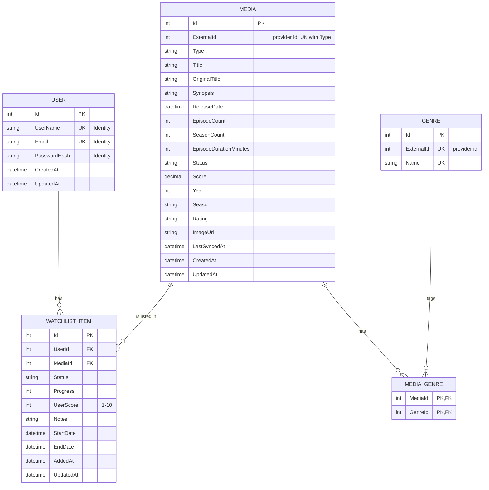

# Data Model

Target data model for WhatchaWatching. It is stored in **MySQL** and accessed through **EF Core** (Pomelo provider). Entities and configurations live in `WhatchaWatching.Infrastructure/Data`. Enums and constants live in `WhatchaWatching.Common`.

> **Status:** entities, configurations, `ApplicationDbContext` and the Identity user model are implemented. The database wiring and the `InitialCreate` migration are done. The Identity setup in the web app is still to do (see [Implementation progress](#implementation-progress)).

## Overview

`Media` and `Genre` are **shared catalog data** fetched from Jikan and stored locally so repeated lookups don't hit the API. `User` and `WatchListItem` are **per-user data**.

## Entities

### Media
A title (anime for now) cached from Jikan.

| Field | Type | Null | Notes |
|---|---|---|---|
| Id | int | no | PK |
| ExternalId | int | no | Id of the title in the external provider (Jikan/MyAnimeList today). Kept provider-neutral. Unique together with `Type`, since anime and manga ids overlap. Used to deduplicate and to find already-stored rows. |
| Type | `MediaType` | no | Anime, Manga, Movie, TVShow. Only Anime is populated for now. |
| Title | string(512) | no | |
| OriginalTitle | string(512) | yes | |
| Synopsis | string(8192) | yes | Jikan synopses can exceed 2048 characters, hence `XXXL_SIZE`. |
| ReleaseDate | datetime | yes | Jikan does not always provide it. |
| EpisodeCount | int | yes | Null for movies or when unknown. |
| SeasonCount | int | yes | Null for movies or when unknown. Jikan does not provide it (each season is a separate entry), so it may stay empty. |
| EpisodeDurationMinutes | int | yes | Filter for the random picker. |
| Status | `MediaStatus` | no | Airing, Finished, Upcoming. |
| Score | decimal(4,2) | yes | Filter for the random picker. |
| Year / Season | int / string | yes | Filters for the random picker. |
| Rating | string(64) | yes | Age rating. |
| ImageUrl | string(512) | yes | |
| LastSyncedAt | datetime | yes | When it was last refreshed from Jikan. |
| CreatedAt / UpdatedAt | datetime (UTC) | no | Set in `SaveChangesAsync`. |

Indexes: unique `(Type, ExternalId)`; non-unique `Type`, `Status`.

### Genre

| Field | Type | Null | Notes |
|---|---|---|---|
| Id | int | no | PK |
| ExternalId | int | no | Unique. Id of the genre in the external provider. |
| Name | string(512) | no | Unique. |

### MediaGenre
Join table for the many-to-many between Media and Genre.

- Composite primary key `(MediaId, GenreId)`. There is no surrogate `Id`.
- Both foreign keys cascade on delete.

### User

`UserEntity` inherits from `IdentityUser<int>`, and `ApplicationDbContext` from `IdentityDbContext<UserEntity, IdentityRole<int>, int>`. Identity owns the account columns: `Id`, `UserName`, `NormalizedUserName`, `Email`, `NormalizedEmail`, `EmailConfirmed`, `PasswordHash`, `SecurityStamp`, `ConcurrencyStamp`, `PhoneNumber`, `PhoneNumberConfirmed`, `TwoFactorEnabled`, `LockoutEnd`, `LockoutEnabled` and `AccessFailedCount`. The project adds only the fields below.

| Field | Type | Null | Notes |
|---|---|---|---|
| CreatedAt / UpdatedAt | datetime (UTC) | no | Set in `SaveChangesAsync`. |
| WatchListItems | collection | | Navigation to the user's watchlist. |

Indexes: unique `UserNameIndex` on `NormalizedUserName` (Identity default); unique `EmailIndex` on `NormalizedEmail` (Identity creates it non-unique, so the project makes it unique).

Identity tables are renamed to match the project: `Users`, `Roles`, `UserRoles`, `UserClaims`, `UserLogins`, `UserTokens` and `RoleClaims`. They are managed by Identity and not detailed here.

### WatchListItem
One user's entry for one media.

| Field | Type | Null | Notes |
|---|---|---|---|
| Id | int | no | PK |
| UserId | int | no | FK → User |
| MediaId | int | no | FK → Media |
| Status | `WatchListItemStatus` | no | PlanToWatch, Watching, Completed, Dropped, OnHold. |
| Progress | int | yes | Episodes watched. Null for movies. |
| UserScore | tinyint | yes | 1–10. |
| Notes | string(2048) | yes | |
| StartDate / EndDate | datetime | yes | |
| AddedAt / UpdatedAt | datetime (UTC) | no | |

Indexes: unique `(UserId, MediaId)`, so a media can appear once per user; non-unique `(UserId, Status)`, for the random picker (`PlanToWatch` items of a user).

## Delete behavior

| Relationship | On delete |
|---|---|
| User → WatchListItem | Cascade |
| Media → WatchListItem | **Restrict**. Media is shared catalog data and cannot be removed while someone lists it. |
| Media → MediaGenre | Cascade |
| Genre → MediaGenre | Cascade |

## Conventions

- **Enums** are stored as strings (`HasConversion<string>()`), so the data stays readable and reordering an enum cannot corrupt it.
- **Timestamps** are UTC and set centrally in `ApplicationDbContext.SaveChangesAsync`, not by the services.
- **String lengths** use `ConfigurationConstants` (`DEFAULT_SIZE` 256, `LARGE_SIZE` 512, `XL_SIZE` 1024, `XXL_SIZE` 2048, `XXXL_SIZE` 8192, plus `SMALL_SIZE` 64).
- **Schema changes** go through EF Core migrations. Connection strings come from configuration or environment variables, never source code.
- **Jikan data** is validated before it is stored. Every optional Jikan field is nullable here.

## Implementation progress

### Step 1: constants, entities and packages (done)

- [x] `ConfigurationConstants`: added `SMALL_SIZE` (64) and `XXXL_SIZE` (8192, used for `Synopsis`).
- [x] `MediaEntity`: `Title` is now `string`, `ReleaseDate` is nullable, `Status` is required. Added `ExternalId`, `EpisodeDurationMinutes`, `Score`, `Year`, `Season`, `Rating` and `LastSyncedAt`. `SeasonCount` is kept.
- [x] `GenreEntity`: added `ExternalId`.
- [x] `MediaGenreEntity`: removed `Id` (the composite key is configured in step 2).
- [x] `UserEntity`: moved into the `Entities` namespace and made its strings non-nullable.
- [x] `WatchListItemEntity`: added `UserScore` (`byte?`), `Notes`, `AddedAt` and `UpdatedAt`.
- [x] `IAuditableEntity` (`UpdatedAt`) added for `Media`, `User` and `WatchListItem`. `ApplicationDbContext` will fill the timestamps in step 3.
- [x] Packages in Infrastructure: `Pomelo.EntityFrameworkCore.MySql` 9.0.0 and `Microsoft.EntityFrameworkCore.Design` 9.0.20. Pomelo has no EF Core 10 release yet, so EF Core is pinned to 9.x to match it (EF Core 10 packages give a NU1608 warning with Pomelo 9.0.0). Revisit when Pomelo supports EF Core 10.

### Step 2: configurations (done)

- [x] Enums (`Type`, `Status`, watchlist `Status`) are stored as strings (`HasConversion<string>()`, max length `SMALL_SIZE`).
- [x] Required/nullable settings now match the entities, and every property is configured explicitly.
- [x] Indexes: unique `(Type, ExternalId)`, `Type` and `Status` on Media. Unique `ExternalId` and unique `Name` on Genre. Unique `Username` and `Email` on User. Unique `(UserId, MediaId)` and `(UserId, Status)` on WatchListItem.
- [x] `MediaGenre` uses the composite key `(MediaId, GenreId)`.
- [x] Check constraint `CK_WatchListItems_UserScore`: `UserScore` is null or between 1 and 10.
- [x] Delete behaviors as in the table above. `Media → WatchListItem` is now `Restrict`.
- [x] Each relationship is configured once, from the dependent side. The duplicate `HasMany` blocks on Media, Genre and User were removed.

### Step 3: DbContext (done)

- [x] `ApplicationDbContext` has the `DbSet`s (`Media`, `Genres`, `MediaGenres`, `WatchListItems`; `Users` is inherited from Identity after step 4) and loads every configuration with `ApplyConfigurationsFromAssembly`.
- [x] `SaveChanges` and `SaveChangesAsync` set `CreatedAt` (or `AddedAt` on `WatchListItem`) on new entities and `UpdatedAt` on new and modified ones, in UTC.
- [x] `Microsoft.EntityFrameworkCore.Relational` 9.0.20 is referenced explicitly. Without it, projects that reference Infrastructure resolve EF Core 9.0.0 (Pomelo's minimum) while Infrastructure compiles against 9.0.20, which breaks the build (CS1705).
- [x] Verified with `Database.GenerateCreateScript()` against a MySQL 8.0 server version (no connection needed): tables, indexes, composite key, check constraint and delete behaviors match this document.

### Step 4: ASP.NET Core Identity in the model (done)

- [x] Package `Microsoft.AspNetCore.Identity.EntityFrameworkCore` 9.0.20 in Infrastructure (kept on 9.x to match EF Core 9 and Pomelo).
- [x] `UserEntity` inherits from `IdentityUser<int>`. Its own `Id`, `Username`, `Email` and `PasswordHash` properties were removed. `CreatedAt`, `UpdatedAt` and `WatchListItems` remain.
- [x] `ApplicationDbContext` inherits from `IdentityDbContext<UserEntity, IdentityRole<int>, int>`. The `Users` `DbSet` now comes from the base class.
- [x] `UserEntityConfiguration` only configures the timestamps and makes `EmailIndex` unique.
- [x] Identity tables are renamed (`Users`, `Roles`, `UserRoles`, `UserClaims`, `UserLogins`, `UserTokens`, `RoleClaims`).
- [x] Generated schema checked again with `GenerateCreateScript()`.

### Step 5: database wiring and first migration (done)

- [x] `DatabaseConstants.CONNECTION_NAME` (`DefaultConnection`) in Common is the single name of the connection string (`ConnectionStrings:DefaultConnection`).
- [x] `AddInfrastructure(IConfiguration)` registers `IDbContextFactory<ApplicationDbContext>` with `UseMySql`, `ServerVersion.AutoDetect` and `EnableRetryOnFailure`. It also registers a scoped `ApplicationDbContext` built from the factory, because Identity resolves the context directly while Blazor Server services should use the factory for short-lived contexts. It throws a clear error when the connection string is missing.
- [x] `AddApplication(IConfiguration)` passes the configuration down, and `Program.cs` calls `AddApplication(builder.Configuration)`.
- [x] `ApplicationDbContextFactory` (design-time, used by `dotnet ef` only) reads `ConnectionStrings:DefaultConnection` from user-secrets (Infrastructure shares the web project's `UserSecretsId`), overridden by the `ConnectionStrings__DefaultConnection` environment variable. Without either, a placeholder connection string with no credentials is used, since creating migrations needs no connection.
- [x] AppHost declares a MySQL container with a data volume and a `DefaultConnection` resource (database `whatchawatching`), referenced by the web app (`WithReference` and `WaitFor`). Docker must be running for `dotnet run --project WhatchaWatching.AppHost`.
- [x] `dotnet-ef` 9.0.20 is a repo-local tool (`dotnet-tools.json`). Run `dotnet tool restore` once.
- [x] Migration `InitialCreate` created in `WhatchaWatching.Infrastructure/Migrations`. The generated SQL was reviewed (tables, indexes, check constraint, delete behaviors), and `has-pending-model-changes` reports none.
- [x] Tests: `AddApplication` builds, registers the context factory, and throws without a connection string.

The migration is **not applied automatically** at startup.

### Working with the database

| Task | Command (from the repo root) |
|---|---|
| Restore the EF tool | `dotnet tool restore` |
| Add a migration | `dotnet ef migrations add <Name> --project WhatchaWatching.Infrastructure` |
| Preview the SQL | `dotnet ef migrations script --project WhatchaWatching.Infrastructure` |
| Apply to a database | `dotnet ef database update --project WhatchaWatching.Infrastructure` (uses the user-secrets connection string) |

The connection string lives in the web project's user-secrets (`ConnectionStrings:DefaultConnection`), which also serves `dotnet ef`. In deployment, set the environment variable `ConnectionStrings__DefaultConnection`. Never commit credentials.

### Later

- Identity setup in the web app: `AddIdentityCore` with `UserEntity`, `RequireUniqueEmail`, cookie authentication, the static login/register pages and auth state for the interactive components.
- An `ICurrentUser` abstraction in Application, so services get the user id without depending on `AuthenticationState`.
- An `IEmailSender` implementation (a no-op one to start) for email confirmation and password reset.

## Decisions

- **Authentication:** ASP.NET Core Identity, with an `int` key. The model side is done (step 4). The web app side is still to do.
- **`MediaType` scope:** all four values (Anime, Manga, Movie, TVShow) are kept. Only Anime is populated for now.

## Database state

- `InitialCreate` (`20261005111804`) was applied to the AlwaysData database `whatcha-watching_database` on 2026-10-05. Further migrations are applied the same way (see [Working with the database](#working-with-the-database)). Be careful: that database is production.
